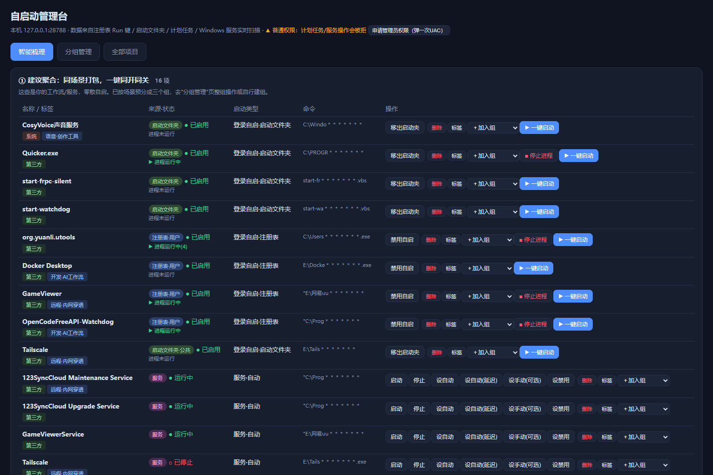
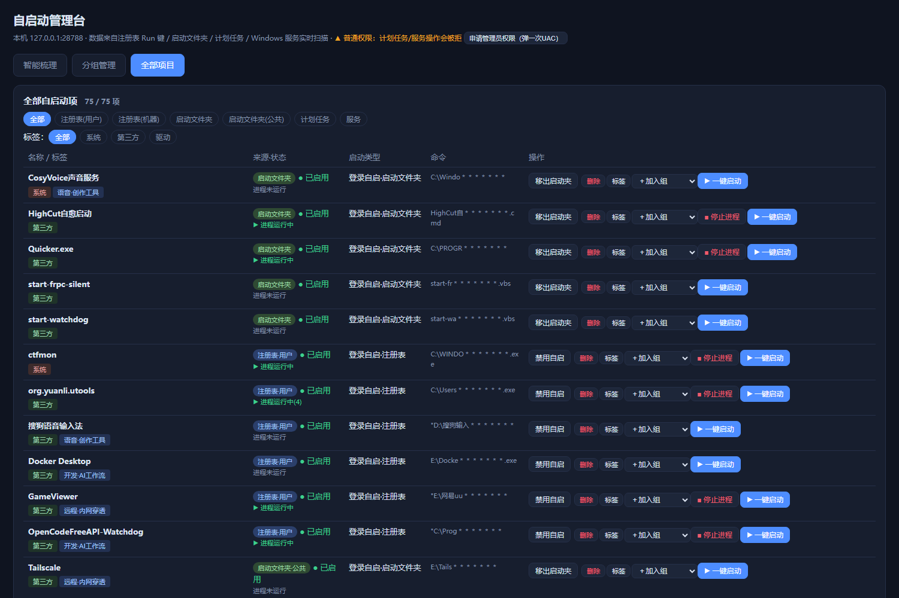

# Windows 自启动管理台（Agent Skill）

一句话打开本地网页管理台，全量管理 Windows 开机自启动。只监听 127.0.0.1，零第三方依赖（Node 后端 + 纯 PowerShell 兜底自动选择）。

```
npx skills add zzall/windows-autostart-manager@windows-autostart-manager
```

装好后对 AI 助手说"打开自启动管理台"即可；没有 AI 助手就双击 `scripts/start.cmd`，浏览器自动打开 `http://127.0.0.1:28788`。

## 界面截图

渐进式扫描（每完成一类立刻打勾报数，不白屏干等）：


智能梳理（自动分四类，带启动类型与标签）：



分组管理（整组一键启动，可增删改）：


全部项目（来源 × 标签双维筛选，逐行启停）：



删除二次确认（注册表项自动备份、文件进回收站、高危默认锁死）：


## 能管什么

四类自启动入口全部覆盖（任务管理器只露出其中一部分）：

| 入口 | 操作 |
|---|---|
| 注册表 Run 键（HKCU/HKLM） | 禁用/恢复/删除（删除前自动备份，可一键还原） |
| 启动文件夹（用户/公共） | 移出/放回/删除（进回收站） |
| 计划任务（开机/登录触发） | 启用/禁用/立即运行/删除 |
| 服务（非 svchost） | 启动/停止/改启动类型（自动/延迟/手动/禁用） |

每一项带**启动类型**、**标签**（系统/驱动/第三方自动归类 + 自定义标签）、**双状态**（自启开关 + 进程是否在跑）。

## 界面功能

- **智能梳理**：自动分四类——建议聚合 / 建议改可选 / 可一键启动 / 保持现状（系统驱动）
- **分组管理**：新建/重命名/删除组，整组一键启动，成员任意增删
- **全部项目**：按来源 × 标签双维筛选，逐行启停
- **在线启停**：▶ 一键启动任意项；■ 按命令行特征停止进程树（vbs/bat 包装项可通过 `match` 关键字打到真实进程）
- **一键提权**：页面按钮弹一次 UAC，自动以管理员重启并接管原端口

## 对话玩法（装了 Skill）

助手可直接调本地 API，不开网页也能完成一切操作：

- "我电脑都自启了什么？" → 分类汇总
- "把豆包自启关了" / "恢复它" → 禁用+备份 / 还原
- "把开发组整个拉起来" → 整组启动
- "有没有自启了但进程起不来的项？" → 揪卸载残留

删除类请求助手会先确认；永久删计划任务/服务需在 `%APPDATA%\windows-autostart-manager\config.json` 中开 `"advanced": true`。

## 配置与数据

- 全部配置、分组、备份存于 `%APPDATA%\windows-autostart-manager\config.json`，删除该目录即无痕卸载
- 服务仅绑定 127.0.0.1，无任何外部网络请求
- 端口默认 28788，占用时自动顺延至 28808

## 目录结构

```
windows-autostart-manager/
├── SKILL.md            # Agent 说明书（含 API 对话操作指引）
├── scripts/server.mjs  # Node 后端
├── scripts/server.ps1  # 纯 PowerShell 后端（无 Node 时兜底）
├── scripts/start.cmd   # 一键启动器（自动选后端 + 开浏览器）
└── assets/index.html   # 网页界面
```

## License

MIT
